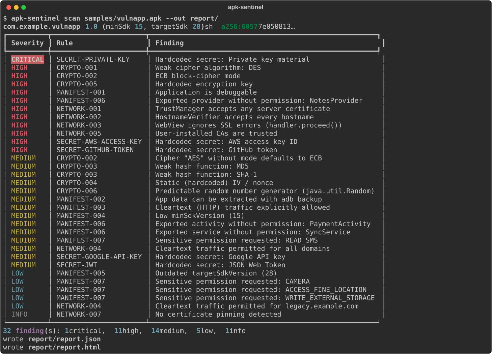
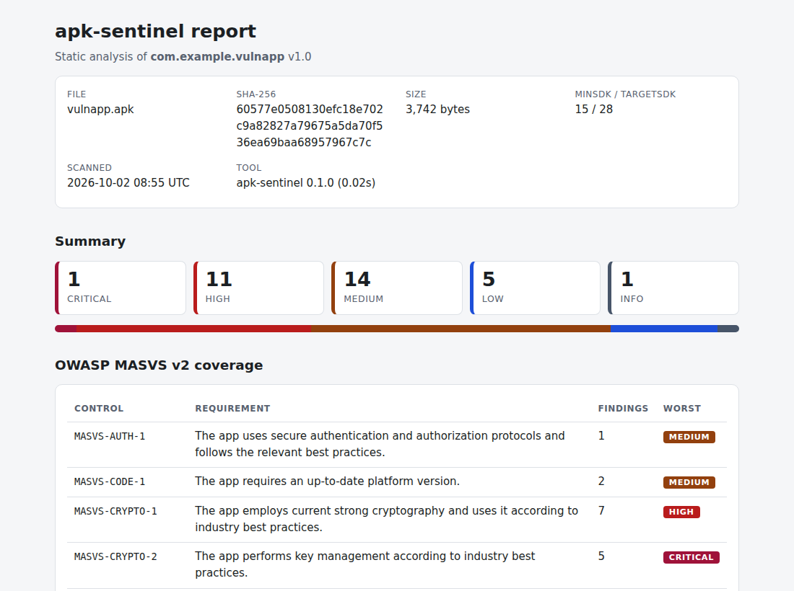
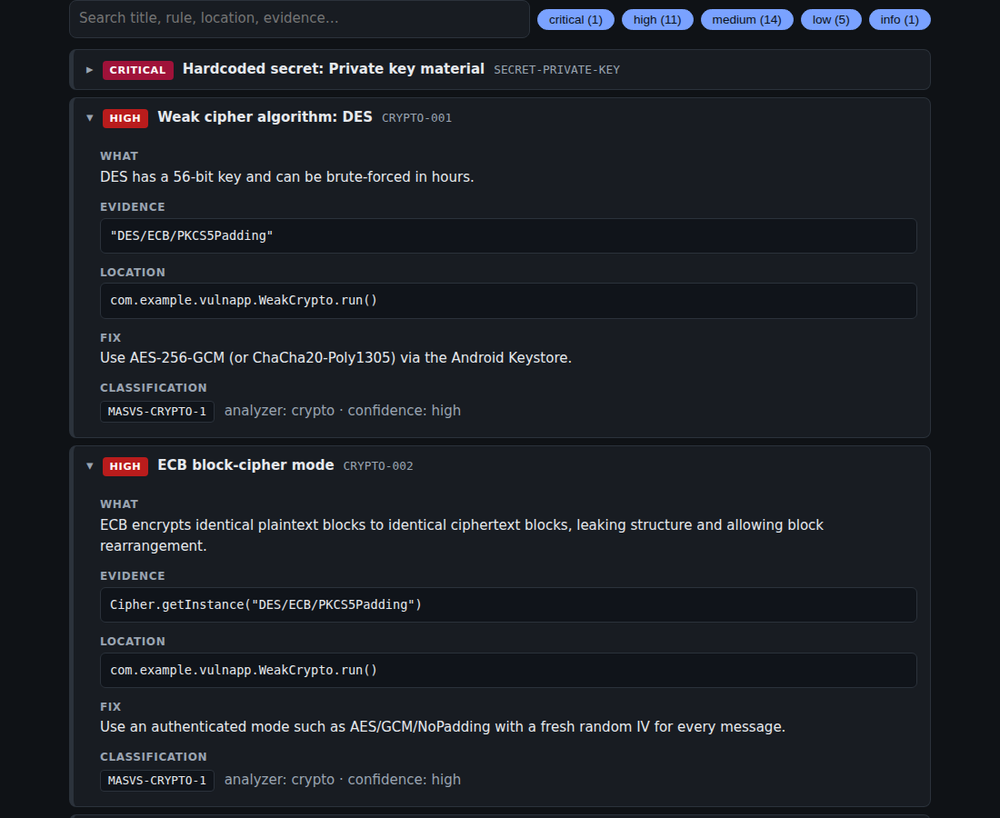

# apk-sentinel

[](https://github.com/vinaythakur-cyber/Android/actions/workflows/ci.yml)


**Static security analyzer for Android APKs.** Give it an `.apk`; get a JSON report and a styled,
self-contained HTML report listing findings with **severity, evidence, location, a fix and the
OWASP MASVS v2 controls** each one violates.

> ### ⚠️ Use only on apps you own or have permission to test
> Analyzing someone else's app can breach its licence, terms of service or the law, and
> publishing the results can harm real users. Practise on intentionally vulnerable apps such as
> [DIVA](https://github.com/payatu/diva-android) or
> [InsecureBankv2](https://github.com/dineshshetty/Android-InsecureBankv2), or on your own builds.
> This repository never contains APK files.



| Report summary (light) | Findings (dark) |
|---|---|
|  |  |

The full sample is in [`docs/sample-report/`](docs/sample-report/) (open `report.html`). It was
produced from the bundled, intentionally vulnerable **fixture app** (see
[Development](#development)); the same commands work on DIVA, see below.

## What it checks

| Analyzer | Looks for |
|---|---|
| **manifest** | debuggable build, `allowBackup`, exported components without a permission, cleartext traffic, low `minSdk`/old `targetSdk`, sensitive permissions |
| **secrets** | AWS keys, Google API keys, private keys, JWTs, GitHub/Slack/Stripe tokens, URL credentials; patterns live in [`rules/secrets.yaml`](src/apk_sentinel/rules/secrets.yaml) |
| **crypto** | DES/RC4/3DES, ECB (and default-ECB `"AES"`), MD5/SHA-1, static IVs, hardcoded keys, `java.util.Random` |
| **network** | trust-all `TrustManager`, always-true `HostnameVerifier`, WebView `proceed()` on SSL errors, `network_security_config.xml` (cleartext, user CAs, pinning) |

Every rule id, severity and MASVS mapping is in [`docs/RULES.md`](docs/RULES.md).

## Install

```bash
git clone https://github.com/vinaythakur-cyber/Android.git apk-sentinel && cd apk-sentinel
python -m venv .venv && source .venv/bin/activate        # Windows: .venv\Scripts\activate
pip install -e .
apk-sentinel --version
```

Requires Python 3.11+.

## Scan an APK

```bash
apk-sentinel scan path/to/app.apk --out report/
open report/report.html        # or xdg-open / start
```

| Option | Meaning |
|---|---|
| `--out, -o DIR` | where `report.json` / `report.html` go (default `report/`) |
| `--format, -f json\|html` | choose formats (repeatable; default both) |
| `--fail-on SEVERITY` | exit status 1 if any finding is at/above `info\|low\|medium\|high\|critical` (for CI) |
| `--include-libraries` | also analyze bundled library code (slower, noisier) |
| `--secrets-rules FILE` | use your own secrets rule file |

Exit codes: `0` ok · `1` `--fail-on` threshold reached · `2` usage/input error (bad APK, adb problem).

## Scan an app that is installed on **your own phone**

You cannot "build" an APK from an installed app, and you do not need to: Android keeps the
original APK on the device and `adb` copies it out. apk-sentinel wraps that.

1. **Phone:** Settings → About phone → tap *Build number* 7× → Settings → Developer options →
   enable **USB debugging**. Connect USB and accept the RSA prompt.
2. **Laptop:** install [Android platform-tools](https://developer.android.com/tools/releases/platform-tools)
   so `adb` is on your `PATH`.
3. Then:

```bash
apk-sentinel devices                       # phone should show state "device"
apk-sentinel packages --filter myapp       # find the package name (user-installed apps)
apk-sentinel pull com.example.myapp        # -> samples/com.example.myapp.apk
apk-sentinel scan samples/com.example.myapp.apk --out report/
```

*Several phones attached?* add `--serial <id>` to `packages`/`pull`. *Split APKs?* `pull` saves
`base.apk` as `<package>.apk` plus `<package>.split_*.apk`; scan the base file (it holds the
manifest and code). `samples/` is git-ignored.

## Docker

```bash
docker build -t apk-sentinel .
docker run --rm -v "$PWD:/work" --user "$(id -u):$(id -g)" apk-sentinel \
    scan samples/app.apk --out report/
```

The image runs as a non-root user. For unknown samples add `--memory=2g --network=none`.

## Try it on DIVA

1. Get the [DIVA source](https://github.com/payatu/diva-android) and build the APK with Android
   Studio (or use any DIVA build you already trust).
2. Scan it:
   ```bash
   apk-sentinel scan diva.apk --out report/
   ```
3. Compare the findings with DIVA's documented challenges (insecure logging, hardcoded issues,
   insecure data storage, input validation ...). Remember static analysis finds *candidates*;
   several DIVA challenges are runtime behaviours that need dynamic testing.

## JSON schema (abridged)

```jsonc
{
  "tool": {"name": "apk-sentinel", "version": "0.1.0"},
  "target": {"package": "...", "sha256": "...", "min_sdk": 15, "target_sdk": 28},
  "summary": {"total": 32, "by_severity": {"critical": 1, "high": 11, "medium": 14, "low": 5, "info": 1}},
  "errors": [],                       // analyzers that crashed (scan continues)
  "findings": [{
    "rule_id": "NETWORK-001", "severity": "high", "confidence": "high",
    "title": "TrustManager accepts any server certificate",
    "evidence": "...", "location": "com.example.TrustAll.checkServerTrusted()",
    "recommendation": "...", "masvs": ["MASVS-NETWORK-1"]
  }]
}
```

## Project layout

```
src/apk_sentinel/
  cli.py            Typer commands: scan, devices, packages, pull
  models.py         Finding, Severity, ScanResult           (output contract)
  apk_model.py      LoadedApk, ManifestInfo, ClassInfo ...  (input contract)
  loader.py         the only module that imports Androguard
  scanner.py        runs analyzers with crash isolation
  analyzers/        manifest.py  secrets.py  crypto.py  network.py  (+ base.py)
  reporting/        json_report.py  html_report.py  templates/report.html.j2
  rules/secrets.yaml
  device.py         adb wrapper
tests/              unit tests (synthetic data) + integration tests (real APK) + fixture_app/
docs/               ARCHITECTURE.md  CONCEPTS.md  RULES.md  sample-report/  img/
scripts/            build_fixture_apk.py
```

Read next: [`docs/ARCHITECTURE.md`](docs/ARCHITECTURE.md) (design and threat model) and
[`docs/CONCEPTS.md`](docs/CONCEPTS.md) (APK, binary XML, DEX, MASVS explained from scratch).

## Development

```bash
pip install -e ".[dev]"
ruff check . && ruff format --check . && mypy && pytest
```

Unit tests need no APK. To run the integration tests against a **real** APK built from the
bundled vulnerable fixture app (needs Java; downloads a SHA-256-pinned apktool once):

```bash
python scripts/build_fixture_apk.py                      # -> samples/vulnapp.apk (git-ignored)
APK_SENTINEL_SAMPLE_APK=samples/vulnapp.apk pytest       # or point it at DIVA / your own APK
```

CI (`.github/workflows/ci.yml`) runs ruff, mypy, pytest with coverage on Python 3.11 and 3.12,
the integration suite on the fixture APK, and a Docker build.

## Limitations

- **Static and heuristic.** It reads literals and call sites; it cannot see values computed at
  runtime, server-side flaws, or behaviour behind obfuscation. Expect some false positives
  (each finding carries a confidence) and false negatives.
- Library code (AndroidX, OkHttp, ...) is skipped by default for speed and signal.
- Native code (`lib/*.so`), `assets/`, and Flutter/React-Native bundles are not analyzed yet.
- Findings are leads for a human reviewer, not a certification.

## License

[MIT](LICENSE)
